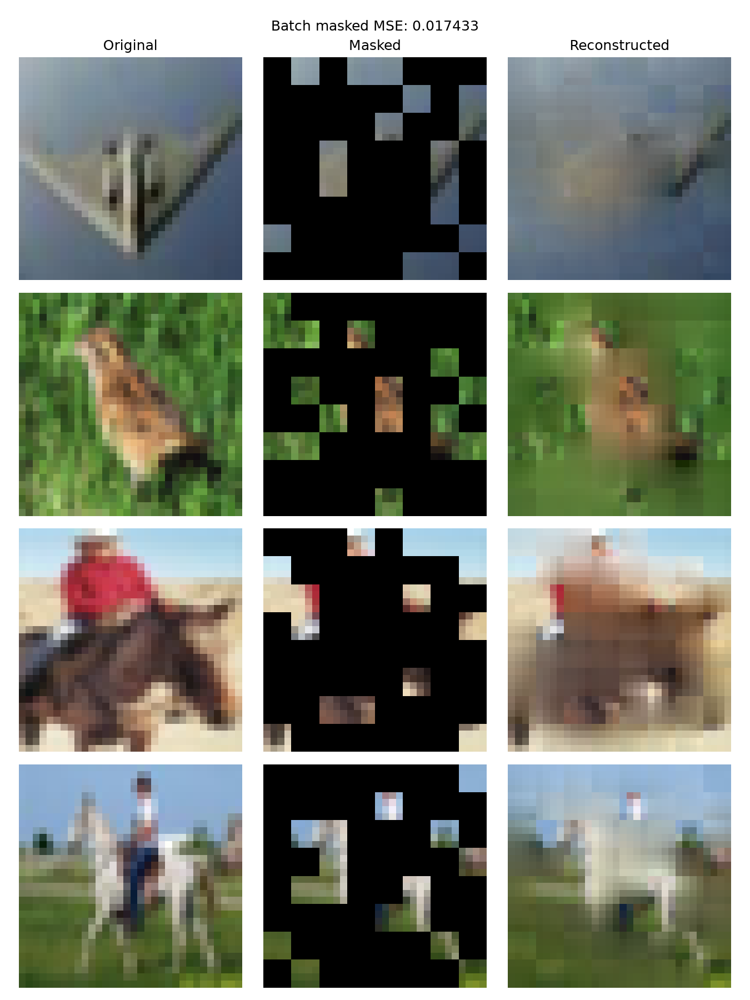
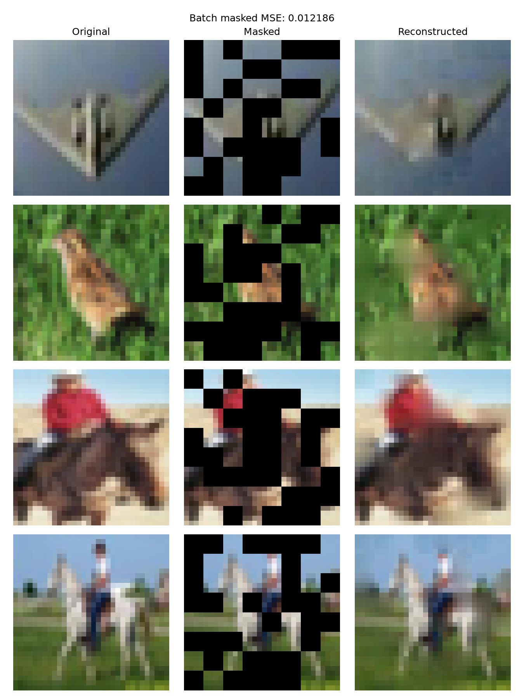
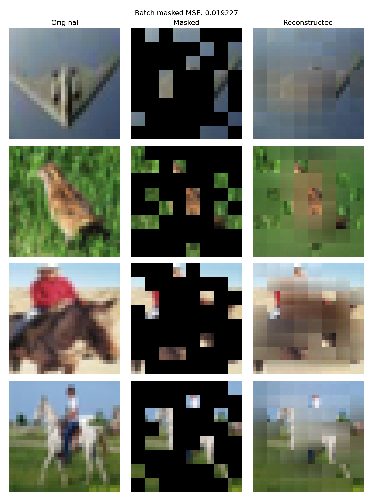
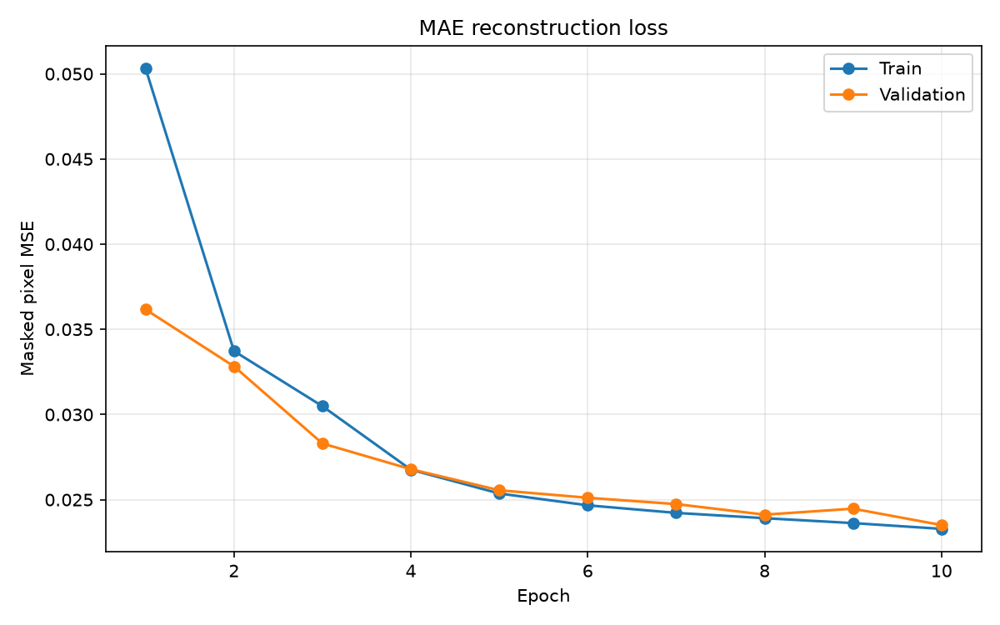

# Mini MAE：使用 PyTorch 实现图像遮挡重建

一个用于学习 Masked Autoencoder（MAE）的 PyTorch 项目，在 CIFAR-10 上完成图块划分、随机遮挡、编码、解码与像素重建。

## 当前实验配置

当前脚本已切换到更大的模型，统一配置位于 `mini_mae/config.py`：编码器 192 维、6 层、6 个注意力头；解码器 96 维、2 层；图块尺寸仍为 4。MAE 预训练设为 20 轮、batch size 32，仍使用 45000/1000 的训练与验证划分。

当前实验为 50% 遮挡率，实验名是 `mae_masked_50`。输出保存到 `outputs/mae_masked_50/`，分类结果放在其 `classifier/` 子目录。分类仍为冻结编码器的线性探测，默认 10 轮、batch size 32。扩大后的模型不能直接加载旧的小模型权重。

下方“遮挡率对比实验”为大模型实验；其后的“重建效果”“模型流程”“实验配置”“训练结果”保留早期小模型基线记录。旧文件保留在原来的 `outputs/` 目录，当前输出目录以本节为准。

## 遮挡率对比实验

两组均使用 192 维、6 层编码器，96 维、2 层解码器，预训练 20 轮、batch size 32，采用相同的 45000/1000 训练与验证划分。分类时输入完整图片，冻结编码器，训练线性分类头 10 轮，以验证准确率选择模型。

| 指标 | 遮挡率 75% | 遮挡率 50% |
|---|---:|---:|
| 可见 / 遮挡图块数 | 16 / 48 | 32 / 32 |
| 最低验证重建 MSE | 0.01964（第 18 轮） | 0.01155（第 19 轮） |
| 最佳分类验证准确率 | 41.40% | 48.00% |
| 分类测试准确率 | 43.93% | 48.23% |

本次实验中，50% 遮挡率对应的分类测试准确率提高了 **4.30 个百分点**。分类时均使用完整图片，因此这一改善不来自分类输入中可见图块数量的差异。

两组重建评估使用不同遮挡率，输入线索与待预测位置不同，MSE 不能作为相同难度下的直接比较。展示图保留了可见区域的真实像素，50% 遮挡时原图保留更多，也有助于整图观感。公平比较重建能力需统一图片、遮挡率和遮挡位置。

每组仅进行了一次实验，尚未使用多个随机种子估计波动，也没有随机初始化编码器的对照。结果不能推广为所有 MAE 都应使用 50% 遮挡率。对于当前模型与训练预算，降低遮挡难度可能更有利于学习可用于分类的特征，这是待进一步验证的解释。

### 遮挡率 75%：重建展示



### 遮挡率 50%：重建展示



原始记录：[75% 预训练指标](outputs/mae_192d_6layers_20epochs/training_history.csv)、[50% 预训练指标](outputs/mae_masked_50/training_history.csv)、[75% 分类结果](outputs/mae_192d_6layers_20epochs/classifier/results.json)、[50% 分类结果](outputs/mae_masked_50/classifier/results.json)。

## 重建效果



从左到右分别为：

- 原始图片。
- 遮挡 75% 图块后的图片。
- 保留可见区域、使用模型预测填补遮挡区域的重建图片。

模型能够恢复部分颜色与粗略结构，细节仍有模糊。重建图中的可见区域来自原图，不代表模型的预测效果。

## 模型流程

```text
输入图片 [B, 3, 32, 32]
    ↓ 图块嵌入与位置编码
图块特征 [B, 64, 64]
    ↓ 随机保留 25% 图块
可见特征 [B, 16, 64]
    ↓ Transformer 编码器
编码特征 [B, 16, 64]
    ↓ 维度转换、放回原位置、填入遮挡向量、加解码器位置编码
完整序列 [B, 64, 32]
    ↓ Transformer 解码器与像素预测层
预测图块 [B, 64, 48]
    ↓ 仅在遮挡位置计算均方误差
重建损失
```

这是一个简化的教学实现：使用可学习位置编码，不使用 CLS token，并根据保留索引恢复图块位置。

## 实验配置

| 参数 | 设置 |
|---|---|
| 数据集 | CIFAR-10 |
| 训练集 / 验证集 | 45000 / 1000 张 |
| 图片尺寸 | 32 × 32 |
| 图块尺寸 | 4 × 4 |
| 遮挡率 | 75% |
| 编码器 | 2 层，特征维度 64 |
| 解码器 | 1 层，特征维度 32 |
| 注意力头数 | 2 |
| Batch size | 64 |
| 优化器 | AdamW |
| 学习率 / 权重衰减 | 0.001 / 0.05 |
| 训练轮次 | 10 |
| 数据划分种子 | 42 |

训练集和验证集从 CIFAR-10 官方训练部分划分，索引不重叠，剩余 4000 张未使用。本实验未报告官方测试集结果。数据划分固定，但训练未设置完整的随机种子配置，因此重新训练的指标可能不同。

## 训练结果



| 指标 | 第 1 轮 | 第 10 轮 |
|---|---:|---:|
| 训练 MSE | 0.05032 | 0.02329 |
| 验证 MSE | 0.03617 | 0.02351 |

本次记录中最低验证损失出现在第 10 轮。完整数值见 [训练记录](outputs/training_history.csv)。

损失仅统计被遮挡图块的像素误差。验证阶段仍使用随机遮挡，因此指标存在一定波动。

当前任务是像素重建，没有统计分类准确率；重建效果也不能直接证明编码器的分类能力。

## 文件结构

```text
mini-mae-pytorch/
├── mini_mae/
│   ├── __init__.py
│   ├── model.py          # 模型、损失与图片还原
│   ├── data.py           # 数据集划分与批次加载
│   └── visualize.py      # 加载权重并展示重建
├── train.py              # 训练、验证与指标记录
├── README.md
└── outputs/
    ├── best_model.pt
    ├── training_history.csv
    ├── loss_curve.png
    └── reconstruction.png
```

## 使用方式

需要安装 PyTorch、torchvision 和 Matplotlib。PyTorch 与 torchvision 应使用相互匹配的版本；根据是否使用 CUDA 选择相应安装方式。

在项目根目录 `mini-mae-pytorch` 运行训练：

```bash
python train.py
```

首次运行会下载 CIFAR-10。每轮保存指标，并在验证损失改善时更新 `outputs/<EXPERIMENT_NAME>/best_model.pt`。当前脚本每次运行从头训练，同名输出会被覆盖，比较实验前请更换实验名或备份已有结果。

生成重建对比图：

```bash
python -m mini_mae.visualize
```

该命令需要已有模型权重，且模型结构必须与训练时一致。对比图保存到 `outputs/<EXPERIMENT_NAME>/reconstruction.png`，同时使用 TkAgg 后端弹出窗口，需要环境支持 Tk 图形界面。比较不同遮挡率时，需要同时修改 `config.py` 的实验名以及 `train.py`、`visualize.py` 的遮挡率。

## 使用预训练编码器进行分类

`mini_mae/classifier.py` 使用完整图片，不进行随机遮挡。冻结图块嵌入、编码器位置编码与编码器，对全部图块特征取平均，再通过一个线性层预测 CIFAR-10 的 10 个类别。解码器不参与分类。

在项目根目录运行：

```bash
python train_classifier.py
```

默认加载 `outputs/<EXPERIMENT_NAME>/best_model.pt`，训练分类头 10 轮。使用与预训练相同的 45000/1000 训练、验证划分，以验证准确率选择最佳分类模型，再评估一次官方测试集。分类脚本记录的是交叉熵和分类准确率，与重建 MSE 不同。

可选参数示例：

```bash
python train_classifier.py --epochs 20 --batch-size 64 --output-dir outputs/classifier_exp2
```

结果写入独立目录 `outputs/<EXPERIMENT_NAME>/classifier/`：

- `best_classifier.pt`：编码器与分类头的参数。
- `history.csv`：每轮训练、验证的交叉熵与准确率，准确率以 0～1 记录。
- `curves.png`：损失与准确率曲线。
- `results.json`：最佳验证准确率、测试集指标与类别名称。

重复运行会覆盖所选分类输出目录中的同名文件。MAE 重建权重不会被修改。此处只训练线性头，尚未实现编码器整体微调；分类实验结果见上方遮挡率对比。

## 学习收获与局限

通过这个项目，我练习了图块嵌入、逐图片随机遮挡、Transformer 编解码、遮挡区域损失，以及训练记录与可视化。

当前模型规模较小、输入分辨率较低，重建结果仍缺少细节。后续可以增加固定遮挡下的评估，并通过冻结编码器的线性分类实验，进一步检查表征质量。

参考：[MAE 官方实现](https://github.com/facebookresearch/mae)。
